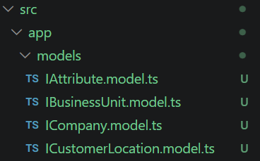

# Angular assignment - Attribute management
## [GitHub](https://github.com/Shreyansh-amicus/Attribute-management-angular)

## Assignment - 1

### Task 1 - Create a new angular application

- Project initialization       


- Why does Angular offer both approaches?      
Angular offers both approaches because the ngModule approach has been present since a very long time and a lot of enterprise applications and packages are written in ngModule, whereas the standalone approach has been the default since Angular 17 making it backward compatible and easier to learn and use Angular.

- In what kind of project would you pick standalone over NgModule?      
Standalone has been the default approach that Angular has opted since Angular 17 because it reduces a lot of boilerplate code and makes development easier and faster as compared to NgModules. I would prefer standalone over NgModules in almost every situation where we don't have to explicity use the rigid, heavy modular approach provided by the NgModules.

### Task 2 - Create TypeScript interfaces



### Task 3 - Create Attribute Service

- Create AttributeService


- In-memory array of at least 8 diverse Attribute records


- What would change if you provided this service at component level? When would you choose that?             
If this service was provided at a component level, then we would have to describe the in memory attribute array and all the related methods to the attribute array in each and every component where it is used, whereas with the service AttributeService we have a global store through which all the components can share the data instead of repeating the same code at multiple places. I would choose the component level definition of the array and methods where only that specific component uses the data and methods of the service.

### Task 4 - Create AttributeListComponent

- Create AttributeListComponent


- Attribute list


### Task 5 - Create AttributeCardComponent 

- Create AttributeCardComponent 


- Attribute card view


- Attribute table view


### Task 6 - Implement ngOnInit, ngOnChanges, ngOnDestroy in AttributeCardComponent

- Console.log() after switching to card layout         


- Console.log() after switching back to table layout          


- In what order do hooks fire when the list loads?         
No hooks fire when the list loads since the table layout is the default layout in the attribute-list component.

- What fires when you switch between table/card view?              
When the toggle is switched from the table view to the card view, ngOnChanges and ngOnInit hooks are fired for each card with its id since the attribute-card component inherits the attributes as @Input from its parent attribute-list component and initializes the card view or layout.           
Whereas when the toggle is switched from the card view to the table view, the card layout no longer exists in the view, therefore the ngOnDestroy hook is fired for each attribute with its id.

- What fires when you remove an attribute? What real-world cleanup would you do in ngOnDestroy?           
When an attribute is removed from the list and its corresponding AttributeCard component is removed from the view, Angular calls ngOnDestroy() for that card instance. The console log displays the ID of the attribute associated with the destroyed component.         
Real world leanup that I would perform in ngOnDestroy hook is to clear up any tasks such as setTimeout and setInterval and clear up any resource which isn't needed any longer to avoid memory leak issues.

### Task 7 - Custom attribute directive appActiveStatus


### Task 8 - Create a custom pipe RelativeTimePipe


### Task 9 - Add a search box

- Add a search box        


- Why use a structural directive instead of a pipe?         
A structural directive controls whether an element exists in the DOM.
Here, it creates the row/card when the attribute matches the search
term and removes it when it doesn't.

A pipe would be more appropriate when the goal is to transform an
array into a filtered array for display.

### Task 10 - Create AddAttributeComponent


### Task 11 - Create EditAttributeComponent


### Task 12 - Comparison: Reactive Forms vs Template-driven Forms

In this project, I implemented both Angular form approaches to understand their differences in implementation, validation, maintainability, and testing.

- **Add Attribute:** Implemented using Reactive Forms (`FormGroup`, `FormControl`, and `Validators`).
- **Edit Attribute:** Implemented using Template-driven Forms (`ngModel` and `NgForm`), with existing attribute data pre-populated into the form.

#### 1. What Was Easier and Harder in This Project?

| Aspect | Reactive Forms — Add Attribute | Template-driven Forms — Edit Attribute |
|---|---|---|
| **Form setup** | Required creating a `FormGroup` and defining each control in TypeScript. | Required importing `FormsModule` and connecting template fields using `ngModel`. |
| **Initial implementation** | Required more TypeScript setup, but the form structure was explicit. | Was quicker to get started with for a relatively simple form. |
| **Validation** | Validators were configured centrally using `Validators.required`, `Validators.minLength`, and a custom validator. | Validation was configured in the template using attributes such as `required`, `minlength`, and `maxlength`. |
| **Dependent dropdowns** | `valueChanges` made it straightforward to respond to Business Unit changes and filter Customer Locations. | Required handling template events and synchronizing the component's form model with dropdown selections. |
| **Pre-populating data** | Values can be set using methods such as `setValue()` and `patchValue()`. | Existing values can be assigned to the component model and displayed using `ngModel`. |
| **Form state** | Control values, validity, touched state, and dirty state are accessible through the form model. | `NgForm` exposes validity and dirty state, but controls must be registered and connected correctly. |
| **Maintainability** | Complex validation and dynamic form behavior can be organized in TypeScript. | Can become harder to manage when the template grows and contains extensive validation or conditional logic. |

**What I learned:**

Reactive Forms required more initial TypeScript setup, but they made validation and dependent dropdown behavior easier to organize and understand. Template-driven Forms were relatively quick to implement for the Edit form because the fields could be connected directly to the component model using `ngModel`.

However, the Template-driven approach requires careful management of form state, control registration, and changes to related dropdowns.

#### 2. When Would I Choose Each Approach in a Real Project?

##### Reactive Forms

I would choose Reactive Forms when:

- The form contains many fields or complex validation rules.
- Fields depend on other fields, such as Customer Location depending on Business Unit.
- The form requires dynamic controls or `FormArray`.
- Validation logic needs to be reused or maintained separately from the HTML template.
- The application requires explicit control over form state and validation.

**Examples:**
- Employee onboarding workflows.
- Product configuration forms.
- Registration workflows with complex validation.
- Multi-step forms with conditional fields.

##### Template-driven Forms

I would choose Template-driven Forms when:

- The form is relatively small and straightforward.
- Most validation can be expressed using standard HTML attributes and Angular template directives.
- The form has limited dynamic behavior.
- The team prefers keeping most of the form configuration in the template.

**Examples:**
- Simple contact forms.
- Basic feedback forms.
- Small settings forms with a few fields.

#### 3. Which Approach Is Easier to Unit Test, and Why?

**Reactive Forms are generally more convenient for unit testing complex form behavior.**

Reactive Forms expose their structure directly through TypeScript. A unit test can set control values, trigger validation, and check the form's validity without relying heavily on template interactions.

For example, to test whether the attribute name is valid:

```typescript
component.attributeForm.controls.AttributeName.setValue('Department');

expect(
  component.attributeForm.controls.AttributeName.valid
).toBeTrue();
```

To verify that the required validator works:

```typescript
component.attributeForm.controls.AttributeName.setValue('');

expect(
  component.attributeForm.controls.AttributeName.hasError('required')
).toBeTrue();
```

Template-driven Forms can also be unit tested. However, Angular needs to initialize the template and register its `ngModel` controls before assertions can reliably inspect the form state. This can require additional fixture setup and asynchronous change detection.

Therefore, Reactive Forms are generally easier to test when a form contains complex validation rules, dynamic controls, or substantial programmatic behavior. Template-driven Forms remain testable and are suitable for simpler forms.

#### 4. Conclusion

Both approaches are useful, and neither is universally better.

In this project, Reactive Forms were a good fit for **Add Attribute** because the form uses a custom attribute-name validator and a dependent Customer Location dropdown. Template-driven Forms provided an opportunity to implement **Edit Attribute** using `ngModel` and `NgForm`.

For a production application with complex forms, I would generally prefer Reactive Forms because their explicit structure, centralized validation configuration, and programmatic control make them easier to maintain and test.

For smaller forms with minimal logic, Template-driven Forms can reduce the amount of setup required.

Ultimately, I would choose the approach based on the form's complexity, validation requirements, maintainability, and testing needs rather than using one approach for every form.

## Assignment 2
### Task 1 – Feature-Based Project Structure

#### 1. Overview

The objective of this task was to reorganize the Attribute Management application into a feature-based folder structure while maintaining the existing standalone component-based architecture.

The application is structured into three main areas:

- **Attribute:** Contains components related to attribute management.
- **Shared:** Contains reusable components, directives, and pipes.
- **Core:** Contains application-wide services and infrastructure such as HTTP interceptors.

#### 2. Project Structure

The application follows the following folder structure:

```text
src/
└── app/
    ├── core/
    │   └── services/
    │       ├── attribute-service.ts
    │       └── lookup-service.ts
    │ 
    │
    ├── shared/
    │   ├── components/
    │   │   └── attribute-card/
    │   ├── directives/
    │   │   ├── active-status.directive.ts
    │   │   └── filter-by.directive.ts
    │   └── pipes/
    │       └── relative-time.pipe.ts
    │
    ├── features/
    │   └── attributes/
    │       ├── components/
    │       │   ├── attribute-list/
    │       │   ├── add-attribute/
    │       │   └── edit-attribute/
    │       └── attribute.routes.ts
    │
    ├── app.routes.ts
    └── app.config.ts
```

#### 3. What Goes Where?

##### Attribute Feature

The Attribute feature contains components that implement the application's main business functionality.

It includes:

- **AttributeListPage:** Displays attributes in table and card views, with search and filtering functionality.
- **AddAttributePage:** Allows users to create new attributes using reactive forms.
- **EditAttributeComponent:** Allows users to update existing attributes using template-driven forms.

##### Shared

The Shared folder contains reusable functionality that can be used by multiple components or features.

It includes:

- **AttributeCard:** Reusable UI component for displaying attribute information.
- **AppActiveStatus:** Custom directive that displays active and inactive status.
- **FilterBy:** Custom structural directive for filtering attributes.
- **RelativeTimePipe:** Custom pipe for displaying dates in relative time format.

These declarations remain standalone and are imported directly into the components that require them.

##### Core

The Core folder contains application-wide services and infrastructure.

It includes:

- **AttributeService:** Manages attribute data and CRUD operations.
- **LookupService:** Provides lookup information such as business units, companies, and customer locations.
- **HTTP Interceptors:** Used for handling common HTTP request and response logic.

Services that should be application-wide singletons use Angular's `providedIn: 'root'` configuration.

#### 4. Why Separate Core from Shared?

Core and Shared have different responsibilities, so separating them improves application organization and maintainability.

| Core | Shared |
|---|---|
| Contains application-wide services | Contains reusable UI functionality |
| Manages application infrastructure | Provides components, directives, and pipes |
| Includes HTTP interceptors | Includes common UI utilities |
| Generally initialized at the application root | Used wherever required |
| Focuses on application-level functionality | Focuses on reusability |

Separating these responsibilities provides the following benefits:

- **Separation of concerns:** Application infrastructure is kept separate from reusable UI functionality.
- **Maintainability:** Services and shared declarations are easier to locate and manage.
- **Reusability:** Shared components, directives, and pipes can be reused across features.
- **Scalability:** New features can be added without unnecessarily increasing the complexity of existing folders.

#### 5. What Happens If CoreModule Is Imported Inside a Lazy-Loaded Module?

In a traditional NgModule-based Angular application, CoreModule is generally imported only once, inside the root AppModule.

If CoreModule is imported inside a lazy-loaded feature module, Angular can create additional instances of providers registered in CoreModule.

This happens because lazy-loaded modules have their own child injectors.

Potential problems include:

- **Duplicate service instances:** Application-wide services may have separate instances.
- **Multiple interceptor registrations:** HTTP interceptors may be registered more than once.
- **Inconsistent application state:** Different parts of the application may work with different service instances.
- **Unexpected behavior:** Duplicate providers can cause issues with shared application data and infrastructure.

To prevent these problems:

1. Import CoreModule only once in the root AppModule.
2. Avoid importing CoreModule inside lazy-loaded feature modules.
3. Use `providedIn: 'root'` for application-wide singleton services.
4. Keep reusable components, directives, and pipes in SharedModule.

**Note:** This section explains the traditional NgModule-based architecture for conceptual understanding. The current Attribute Management application continues to use standalone components and does not implement actual CoreModule or SharedModule classes.

#### 6. Benefits of the Feature-Based Structure

The new folder organization provides several benefits:

- **Better organization:** Related components and services are grouped according to their responsibilities.
- **Separation of concerns:** Business functionality, shared UI functionality, and application infrastructure are kept separate.
- **Improved reusability:** Shared components, directives, and pipes can be imported wherever needed.
- **Lazy loading:** Attribute feature routes can be loaded on demand using Angular's standalone routing configuration.
- **Easier maintenance:** Changes to one feature are less likely to affect unrelated parts of the application.

#### 7. Conclusion

The Attribute Management application has been reorganized into Attribute, Shared, and Core areas while preserving its standalone component-based architecture.

The Attribute feature contains the main application components, Shared contains reusable UI elements, and Core contains application-wide services and infrastructure.

### Task 2 – Routing and Lazy Loading

#### 1. Overview

The objective of this task was to configure application routing for the Attribute Management application and implement lazy loading for the Attribute feature.

The application uses Angular's standalone component-based routing architecture.

The following routes were implemented:

| Route | Component | Description |
|---|---|---|
| `/attributes` | AttributeListPage | Displays the list of attributes |
| `/attributes/add` | AddAttributePage | Allows users to add attributes |
| `/attributes/:id/edit` | EditAttributeComponent | Allows users to edit an existing attribute |
| `/dashboard` | DashboardComponent | Displays a dashboard placeholder |
| `**` | PageNotFoundComponent | Handles unknown routes |

The root URL (`/`) redirects to `/attributes` by default.

#### 2. Lazy Loading Implementation

Lazy loading was implemented using Angular's `loadChildren` routing configuration.

Instead of loading all Attribute components when the application starts, Angular loads the Attribute feature's route configuration only when the user navigates to `/attributes`.

The feature routes are maintained separately in `attribute.routes.ts`.

This keeps the root routing configuration clean and separates feature-specific routing from application-level routing.

Since the application follows a standalone architecture, the implementation uses lazy-loaded route configurations rather than an actual AttributeModule NgModule.

#### 3. Why Use Lazy Loading?

Lazy loading improves application performance by avoiding the need to load every feature when the application initially starts.

Benefits include:

- **Reduced initial loading:** Feature code is downloaded only when required.
- **Better performance:** Smaller initial JavaScript payloads can improve application startup.
- **Code separation:** Feature-specific routes and components remain organized separately.
- **Scalability:** Additional features can be lazy-loaded independently.

#### 4. How Was Lazy Loading Verified?

Lazy loading was verified using the browser's Developer Tools Network tab.

The following steps were performed:

1. Started the Angular application using `ng serve`.
2. Opened the browser Developer Tools.
3. Navigated to `/anything` first to load page-not-found page.
4. Navigated to `/attributes`.
5. Observed a new JavaScript chunk request in the Network tab.

**Observation:**

When navigating to `/anything`, the Attribute feature was not required.

When navigating to `/attributes`, Angular dynamically loaded the Attribute feature's route configuration and its required dependencies through a separate JavaScript chunk.

This confirms that the Attribute feature is configured for lazy loading.

**Screenshot Evidence:**

- Initial load(page not found)


- Lazy load(/attributes)


#### 5. Conclusion

Application routing was successfully configured for Attribute List, Add Attribute, Edit Attribute, Dashboard, and Page Not Found.

Lazy loading was implemented using standalone route configuration with `loadChildren`.

The implementation maintains the existing component-based architecture while improving feature organization and avoiding unnecessary loading of feature code during application startup.

### Task 3 – Authentication Guard (CanActivate)

#### 1. Overview

The objective of this task was to implement route protection using Angular's functional `CanActivate` guard.

A simple authentication mechanism was created using an `AuthService` with a hardcoded login status flag.

No backend or actual credential verification is involved. The purpose is to understand how Angular route guards control navigation based on authentication status.

#### 2. AuthService Implementation

An `AuthService` was created to manage the authentication state of the application.

It maintains an `isLoggedIn` flag using an Angular Signal.

The service provides the following methods:

- **isLoggedIn():** Returns the current authentication status.
- **login():** Sets the authentication status to `true`.
- **logout():** Sets the authentication status to `false`.

The service uses `providedIn: 'root'` to ensure that the same service instance is available throughout the application.

#### 3. AuthGuard Implementation

A functional `CanActivate` guard was implemented to protect routes that require authentication.

The guard performs the following operations:

1. Injects AuthService and Angular Router.
2. Checks whether the user is logged in.
3. If the user is authenticated, it returns `true` and allows navigation.
4. If the user is not authenticated, it redirects them to the Login page.
5. The originally requested URL is passed as a `returnUrl` query parameter.

For example, if an unauthenticated user tries to access `/attributes/101/edit`, they are redirected to:

`/login?returnUrl=%2Fattributes%2F101%2Fedit`

After successful login, the application redirects them to their originally requested page.

#### 4. LoginComponent Implementation

A standalone LoginComponent was created with a simple username and password form.

The form uses Angular's template-driven forms through `FormsModule`.

The login process works as follows:

1. The user enters a username and password.
2. Required-field validation ensures both fields are provided.
3. When the Login button is clicked, the `login()` method of AuthService is called.
4. The authentication flag is updated to `true`.
5. The application reads the `returnUrl` query parameter.
6. The user is redirected to the requested page, or to `/attributes` if no valid return URL is available.

**Note:** This is a demonstration-only login mechanism. Any non-empty username and password are accepted. No real authentication or backend validation is performed.

#### 5. Route Protection

The AuthGuard was applied to the Add Attribute and Edit Attribute routes using `canActivate`.

| Route | Authentication Required |
|---|---|
| `/attributes` | No |
| `/attributes/add` | Yes |
| `/attributes/:id/edit` | Yes |
| `/dashboard` | No |
| `/login` | No |

The Attribute List and Dashboard remain publicly accessible, while Add and Edit operations require authentication.

The existing `CanDeactivate` guard on the Edit Attribute route was also retained to prevent users from accidentally leaving with unsaved changes.

#### 6. Testing and Verification

The following scenarios were tested:

| Test Scenario | Expected Result |
|---|---|
| Access `/attributes/add` without login | Redirect to Login |
| Access `/attributes/101/edit` without login | Redirect to Login |
| Submit login form with non-empty values | Authentication flag becomes `true` |
| Login after requesting Add Attribute | Redirect to `/attributes/add` |
| Login after requesting Edit Attribute | Redirect to the requested Edit URL |
| Access `/attributes` without login | Access allowed |
| Access `/dashboard` without login | Access allowed |

#### 7. Limitations

Since this task uses a hardcoded authentication flag:

- No backend authentication is implemented.
- Username and password are not verified against a database.
- Authentication state is maintained only in memory.
- Refreshing the browser resets the login status to `false`.
- The route guard provides client-side navigation control, not production-level security.

In a real-world application, authentication and authorization must also be enforced by the backend.

#### 8. Conclusion

A functional Angular AuthGuard was successfully implemented using `CanActivate`.

The AuthService manages the login state, and the LoginComponent provides a simple interface for changing that state.

The Add Attribute and Edit Attribute routes are now protected, while public routes remain accessible without authentication.

This task demonstrates how Angular route guards can be used to control navigation based on authentication status.

### Task 7 – DTO Mapping

#### 1. Overview

DTO (Data Transfer Object) mapping is used to separate the API data structure from the application's internal data model.

The backend API returns attribute data in `snake_case`, whereas the Angular application uses the `IAttributeModel` interface with its own property naming convention.

A `MappingService` is responsible for converting API responses into application models and application models into API-compatible DTOs.

#### 2. AttributeDTO

The `AttributeDTO` interface represents the structure of the data received from or sent to the API.

It follows the API's `snake_case` naming convention.

```ts
export interface AttributeDTO {
  attribute_id: number;
  attribute_name: string;
  business_unit_name: string;
  customer_location_name?: string;
  company_name?: string;
  is_active: boolean;
  created_on: string;
  created_by?: string;
  updated_on?: string;
  updated_by?: string;
}

export type CreateAttributeDTO = Omit<AttributeDTO, 'attribute_id'>;
```

The `created_on` and `updated_on` properties are represented as strings because dates are transferred through JSON as serialized values.

#### 3. MappingService

The `MappingService` handles conversions between the API DTO and the Angular application model.

It provides the following methods:

- `toAttribute(dto)`: Converts an API DTO into an `IAttributeModel`.
- `toDTO(attribute)`: Converts an application model into an API DTO.
- `toCreateDTO(attribute)`: Creates an API-compatible DTO for POST requests, excluding the ID generated by the API.

The service also converts serialized date strings into JavaScript `Date` objects when receiving API responses and serializes dates using ISO 8601 when sending data.

#### 4. API Integration

The `AttributeService` uses `MappingService` to ensure that API data is converted before it reaches the components.

The mapping process is applied to all relevant API operations:

| HTTP Operation | Mapping |
|---|---|
| GET all attributes | Each `AttributeDTO` is converted using `toAttribute()` |
| GET attribute by ID | Response is converted using `toAttribute()` |
| POST attribute | Request is converted using `toCreateDTO()` and response using `toAttribute()` |
| PUT attribute | Request is converted using `toDTO()` and response using `toAttribute()` |
| DELETE attribute | No response mapping is required because the operation does not return an attribute object |

RxJS `map()` is used to transform API responses before returning them from the service.

Consequently, components work exclusively with the application's `IAttributeModel` rather than directly accessing the API's DTO structure.

#### 5. Why Not Use API Responses Directly in Components?

Using API responses directly inside components creates unnecessary dependencies between the frontend and backend data structures.

DTO mapping provides several advantages:

**Separation of Concerns**

Components focus on displaying and managing application data instead of handling API-specific transformations.

**Backend Independence**

If the backend changes its response structure or naming convention, only the DTO and mapping logic need to be updated. Components can continue using the same application model.

**Consistent Data Types**

The mapping service converts serialized date strings into JavaScript `Date` objects, allowing components to work with consistent data types.

**Maintainability**

Centralizing transformations in one service avoids duplicating conversion logic across multiple components.

**Type Safety**

Separate DTO and application model interfaces make the API contract and internal application structure explicit, reducing accidental property mismatches.

#### 6. Data Flow

The overall mapping process follows this flow:

```text
                 Backend API
                      |
                      |
                 AttributeDTO
                 (snake_case)
                      |
                      v
                MappingService
                 toAttribute()
                      |
                      v
                IAttributeModel
                (Application Model)
                      |
                      v
                 Components
```

For outgoing requests, the process works in reverse:

```text
                 Components
                      |
                      v
                IAttributeModel
                      |
                      v
                MappingService
                  toDTO()
                      |
                      v
                 AttributeDTO
                 (snake_case)
                      |
                      v
                  Backend API
```

#### Conclusion

DTO mapping creates a clear boundary between the backend API contract and the Angular application's internal data model.

By routing API responses through `MappingService` inside `AttributeService`, the application maintains consistent data structures, improves maintainability, and prevents components from becoming tightly coupled to backend implementation details.

### Task 9 - Create an HttpInterceptor
#### HTTP Interceptor Execution Order

Angular executes HTTP interceptors in the order in which they are registered using `withInterceptors()`.

For example:

```ts
provideHttpClient(
  withInterceptors([
    authInterceptor,
    requestInterceptor,
    errorInterceptor
  ])
);
```

**Outgoing request order:**
1. AuthInterceptor
2. RequestInterceptor
3. ErrorInterceptor
4. HTTP Backend

**Incoming response order:**
1. ErrorInterceptor
2. RequestInterceptor
3. AuthInterceptor

The order is controlled by changing the order of interceptors in the `withInterceptors()` array.

This follows a request/response chain: requests move forward through the interceptor chain, while responses move backward through it.

### Task 10 – HTTP Request Retry Logic

#### 1. Overview

Retry logic is implemented using the RxJS `retry()` operator inside the HTTP interceptor.

The application automatically retries failed GET requests up to two additional times, with a delay of one second between attempts.

Other HTTP methods, including POST, PUT, PATCH, and DELETE, are not retried.

#### 2. Retry Configuration

```ts
retry({
  count: req.method === 'GET' ? 2 : 0,
  delay: () => timer(1000),
})
```

- `count: 2` allows two retries after the initial request.
- GET requests are eligible for retries.
- Other HTTP methods receive zero retries.
- `timer(1000)` introduces a one-second delay between retry attempts.

Therefore, a GET request can make a maximum of three attempts: one initial request and two retries.

#### 3. Why Are Mutation Requests Not Retried?

Mutation requests can modify server-side data. Automatically retrying them may cause unintended side effects.

For example, if a POST request successfully creates an attribute but its response is lost due to a network failure, retrying the request could create a duplicate attribute.

Similarly, repeated PATCH operations may apply changes multiple times, and repeated operations can trigger unintended side effects depending on the backend implementation.

GET requests are generally safe and idempotent because they retrieve data without modifying server-side state.

For these reasons, automatic retry logic is restricted to GET requests in this application.

#### 4. Error Handling

If all retry attempts fail, the error is passed to the interceptor's existing error-handling logic.

The interceptor then handles applicable HTTP status codes, such as:

- **401 Unauthorized:** Redirects the user to the login page.
- **500 Internal Server Error:** Displays a user-friendly error message through `ToastService`.

#### 5. Conclusion

Retry logic improves resilience against temporary request failures while avoiding automatic repetition of operations that may modify server-side data.

### Task 11 – Reactive Search with RxJS

#### 1. Overview

The previous directive-based filtering implementation was replaced with reactive search using Angular Reactive Forms and RxJS.

Instead of filtering an already-loaded array in the browser, the application sends search requests to the API and displays the filtered results.

The search implementation uses:

- `FormControl.valueChanges`
- `debounceTime(300)`
- `distinctUntilChanged()`
- `switchMap()`

#### 2. Search Implementation

A `FormControl` tracks changes to the search input.

Its `valueChanges` observable is used to create a reactive search pipeline.

The search pipeline performs the following operations:

1. `startWith()`: Triggers the initial loading of attributes.
2. `map()`: Trims whitespace from the search term.
3. `distinctUntilChanged()`: Prevents consecutive identical search values from triggering unnecessary requests.
4. `tap()`: Displays the searching indicator and clears previous search errors.
5. `debounceTime(300)`: Waits 300 milliseconds after the user stops typing before initiating the search.
6. `switchMap()`: Calls the filtered API endpoint and switches to the latest search request.
7. `catchError()`: Handles failed search requests without terminating the search stream.
8. `takeUntilDestroyed()`: Automatically cleans up the subscription when the component is destroyed.

#### 3. Why Use debounceTime()?

Without debouncing, every character typed by the user could trigger a separate API request.

For example, searching for "Finance" could generate six requests as the user types each character.

`debounceTime(300)` waits until the user has stopped typing for 300 milliseconds before triggering the search.

This reduces unnecessary API calls, network traffic, and backend processing.

#### 4. Why Use distinctUntilChanged()?

`distinctUntilChanged()` prevents consecutive identical search values from triggering duplicate API requests.

For example, if the search input emits "Finance" multiple times consecutively, only the first value is processed.

This avoids unnecessary repeated requests.

#### 5. Why Use switchMap()?

`switchMap()` ensures that the application processes the latest search request.

Consider a situation where a user searches for "Fin" and then quickly changes the search to "Finance".

The first request might take longer than the second request. Without `switchMap()`, the older response could arrive later and overwrite the latest search results.

`switchMap()` unsubscribes from the previous inner observable when a new search value arrives after debouncing. This prevents outdated responses from updating the component.

#### 6. Searching Indicator

A searching indicator is displayed immediately when the search value changes.

The indicator remains visible while the search is being debounced and while the API request is being processed.

It is hidden when the request succeeds or fails.

#### 7. Migration from Directive-Based Filtering

Previously, the application used a custom `FilterBy` directive to filter the locally available attribute collection.

The implementation was refactored to use reactive search through `FormControl.valueChanges` and API requests.

This moves the filtering responsibility from the UI directive to the API integration layer and supports server-side searching.

#### Conclusion

Reactive search provides a more scalable approach to searching application data.

By combining debouncing, duplicate-value detection, and request switching, the application reduces unnecessary API calls and prevents outdated search results from replacing newer results.

### Task 13 – Centralized State Management Using BehaviorSubject

#### 1. Objective

The objective of this task was to implement a centralized state management approach using **RxJS BehaviorSubject**.

Instead of maintaining application data independently inside different components and services, a centralized `StoreService` was introduced to manage shared application state.

The store maintains the following state:

- `attributes[]` – Stores the list of attributes.
- `lookups` – Stores Business Units, Companies, and Customer Locations.
- `isLoading` – Tracks whether data is currently being loaded.
- `isAuthenticated` – Tracks the user's authentication status.

This approach provides a single source of truth for shared application data.

#### 2. StoreService Implementation

Created `StoreService` inside:

`src/app/core/services/store.ts`

The service uses a `BehaviorSubject<AppState>` to maintain the current application state.

**Why BehaviorSubject?**

A `BehaviorSubject` stores the latest emitted value and immediately provides that value to new subscribers. This is useful when multiple components need access to the same application data, even if they subscribe at different times.

The store exposes its state through observable slices:

- `attributes$`
- `lookups$`
- `isLoading$`
- `isAuthenticated$`

Components and services can subscribe to these observables without directly modifying the internal `BehaviorSubject`.

A snapshot getter was also provided for cases where the current state is needed synchronously, such as retrieving selected lookup values during form submission.

#### 3. Centralized State Updates

All state changes are performed through methods exposed by `StoreService`.

The implementation includes methods such as:

- `setAttributes()` – Replaces the current attribute collection.
- `addAttribute()` – Adds a newly created attribute.
- `updateAttribute()` – Updates an existing attribute.
- `removeAttribute()` – Removes an attribute by ID.
- `setLookups()` – Updates lookup data.
- `setLoading()` – Updates the loading state.
- `setAuthenticated()` – Updates authentication status.

The store uses the spread operator and array methods such as `map()` and `filter()` to create new references instead of modifying existing state.

For example:

```typescript
addAttribute(attribute: IAttributeModel): void {
  this.updateState({
    attributes: [...this.snapshot.attributes, attribute]
  });
}
```

Updating an existing attribute:

```typescript
updateAttribute(updatedAttribute: IAttributeModel): void {
  this.updateState({
    attributes: this.snapshot.attributes.map(attribute =>
      attribute.AttributeId === updatedAttribute.AttributeId
        ? updatedAttribute
        : attribute
    )
  });
}
```

Removing an attribute:

```typescript
removeAttribute(id: number): void {
  this.updateState({
    attributes: this.snapshot.attributes.filter(
      attribute => attribute.AttributeId !== id
    )
  });
}
```

#### 4. Migrating AttributeService to StoreService

The `AttributeService` was updated to communicate with the centralized store.

Previously, components were responsible for maintaining their own copies of attribute data. After this migration, the service updates the store after successful API operations.

The following operations were connected to the store:

| API Operation | Store Update |
|---|---|
| GET all attributes | Updates `attributes[]` |
| GET attributes with search | Updates `attributes[]` with filtered results |
| POST attribute | Adds the created attribute |
| PUT attribute | Updates the existing attribute |
| PATCH attribute | Updates the modified attribute |
| DELETE attribute | Removes the deleted attribute |

The service also updates the loading state when fetching attributes.

For example:

```typescript
getAttributes(): Observable<IAttributeModel[]> {
  this.store.setLoading(true);

  return this.http.get<AttributeDTO[]>(this.apiUrl).pipe(
    map(dtos => dtos.map(dto => this.mapper.toAttribute(dto))),
    tap(attributes => this.store.setAttributes(attributes)),
    finalize(() => this.store.setLoading(false))
  );
}
```

The `tap()` operator performs the store update after the API response is received without changing the emitted data.

The `finalize()` operator resets the loading state when the request completes, errors, or is cancelled.

#### 5. Migrating AuthService to StoreService

The `AuthService` was also migrated to use the centralized store.

Instead of maintaining a separate authentication variable, it now reads and updates the `isAuthenticated` state through `StoreService`.

The service exposes:

- `login()` – Updates authentication state after successful validation.
- `logout()` – Resets authentication state.
- `isAuthenticated` – Provides the current authentication status.
- `isAuthenticated$` – Exposes authentication status as an observable.

This allows route guards and other application components to access the same authentication state.

**Note:** The current authentication implementation is a demonstration using in-memory state. Authentication status resets when the application is refreshed because no persistent authentication mechanism or backend authentication flow has been implemented.

#### 6. Migrating Components to AsyncPipe

Components that display shared application data were updated to consume observable state from `StoreService` using Angular's `AsyncPipe`.

The `AsyncPipe` automatically subscribes to the observable, provides its latest emitted value to the template, and handles subscription cleanup when the component is destroyed.

**AttributeList Component**

The AttributeList component now consumes:

- `attributes$` – Displays the attributes maintained by the store.
- `isLoading$` – Displays the loading indicator.

Instead of maintaining a separate local copy of the attribute collection, the component receives the latest data from the centralized store.

Example:

```typescript
readonly attributes$ = this.store.attributes$;
readonly isLoading$ = this.store.isLoading$;
```

Template usage:

```html
@if (isLoading$ | async) {
  <p>Loading attributes...</p>
}

@if (attributes$ | async; as attributes) {
  @for (attribute of attributes; track attribute.AttributeId) {
    <app-attribute-card [attribute]="attribute" />
  }
}
```

**AddAttribute and EditAttribute Components**

Both components now consume `lookups$` from the store.

Business Units, Companies, and Customer Locations are loaded through the Lookup service and then stored centrally using `setLookups()`.

The templates use `AsyncPipe` to access the lookup data.

This avoids maintaining separate copies of shared lookup information across components.

#### 7. Why Is Immutability Important?

Immutability means creating a new object or array whenever state changes instead of directly modifying the existing object or array.

For example, consider adding an attribute.

**Mutable approach – Avoid this:**

```typescript
this.snapshot.attributes.push(attribute);
```

This modifies the existing array without creating a new reference.

**Immutable approach – Used in this task:**

```typescript
this.updateState({
  attributes: [...this.snapshot.attributes, attribute]
});
```

This creates a new array containing the existing attributes and the newly added attribute.

##### Benefits of Immutability

1. **Reliable change detection:** New object and array references make state changes easier for Angular and other reactive consumers to detect.
2. **Works correctly with distinctUntilChanged:** Reference-based comparisons can detect a new array or object. Mutating an existing reference may cause an update to be suppressed.
3. **Predictable state:** Previous state is not unexpectedly modified when a new state is created.
4. **Easier debugging:** State changes are easier to trace because each update produces a new state reference.
5. **Better maintainability:** Components and services can reason about state changes without worrying about unexpected mutations elsewhere.

##### What Can Break If We Mutate State?

If an existing array or object is modified directly:

- Subscribers using reference-based comparisons may not receive the expected notification.
- Components relying on reference changes may not update as expected.
- Previously stored references may unexpectedly reflect modified data.
- Debugging becomes harder because the original state has already been changed.

For example, using `push()` on the existing attributes array retains the same array reference. If an observable uses `distinctUntilChanged()`, it may consider the new emission unchanged and suppress it.

**Important:** Angular does not universally require immutable state updates. However, immutability makes reactive state management more predictable and works particularly well with reference-based change detection and RxJS operators.

#### 8. Final Application Data Flow

The centralized state approach follows this flow:

```text
       Component
           |
           | Calls service method
           v
    AttributeService
           |
           | HTTP Request
           v
       Backend API
           |
           | API Response
           v
    AttributeService
           |
           | Updates StoreService
           v
      StoreService
      (BehaviorSubject)
           |
           | Emits updated state
           v
     Observable Slices
           |
           | AsyncPipe
           v
       Component UI
```

Authentication follows a similar approach:

```text
    Login Component
           |
           v
       AuthService
           |
           v
      StoreService
           |
           v
   isAuthenticated$
           |
           v
      Route Guard
```

#### 9. Conclusion

Task 13 introduced centralized state management using `BehaviorSubject`.

The application now has a single store for shared attribute data, lookup information, loading status, and authentication status.

`AttributeService` and `AuthService` update the centralized store, while components consume the required state through observable slices and Angular's `AsyncPipe`.

All state updates follow an immutable approach using the spread operator, `map()`, and `filter()`.

This implementation reduces duplicated state across components, improves consistency, and provides a foundation for more advanced state management solutions such as NgRx.

## Assignment 3

### Task 7 – TrackBy and DOM Optimization

#### Objective

Improve list-rendering performance by using Angular's tracking functionality to minimize unnecessary DOM node recreation when a collection is refreshed from the API.

The task also involves adding a Refresh button to reload attributes and comparing DOM behavior with and without stable tracking.

#### 1. Implementation

This project uses Angular's modern `@for` control flow syntax instead of the older `*ngFor` directive.

Angular's `@for` requires a `track` expression, which serves the same purpose as `trackBy` in `*ngFor`.

The attribute card list uses:

```html
@for (attr of tableAttributes; track attr.AttributeId) {
  <app-attribute-card
    [attribute]="attr"
    [canManage]="(isAdmin$ | async) === true"
  />
}
```

Here, `AttributeId` is used as the unique identifier for each attribute.

Angular uses this identifier to determine whether an item already exists in the rendered collection or whether it needs to create a new DOM node.

#### 2. Refresh Button

A Refresh button was added to reload attributes from the API.

Instead of retrieving the entire collection, the refresh functionality re-emits the current pagination query through `tableQuerySubject`.

```typescript
refreshAttributes(): void {
  if (this.isRefreshing || this.tableLoading) {
    return;
  }

  this.isRefreshing = true;

  this.tableQuerySubject.next({
    ...this.tableQuerySubject.value,
  });
}
```

This preserves the existing:
- Page number.
- Page size.
- Sorting column and direction.
- Search term.

The existing API-loading pipeline handles the request and updates the displayed records.

The loading state was also adjusted so that existing records remain rendered while refreshing. This is important because removing the entire list during loading would destroy the existing DOM nodes before Angular could reuse them.

#### 3. Testing Without Stable Tracking


To simulate the behavior without tracking by a unique identifier, the tracking expression was temporarily changed to:

```html
@for (attr of tableAttributes; track attr) {
  <app-attribute-card
    [attribute]="attr"
  />
}
```

This uses object identity (object reference) to identify items.

When the Refresh button is clicked:
1. The application fetches the attributes again from the API.
2. The mapping service creates new JavaScript object instances.
3. The new objects have different references from the previous objects.
4. Angular treats them as new items and recreates their corresponding DOM nodes.

**Expected result:** Existing DOM nodes are not reused when the API returns new object instances.

#### 4. Testing With Stable Tracking


The tracking expression was restored to:

```html
@for (attr of tableAttributes; track attr.AttributeId) {
  <app-attribute-card
    [attribute]="attr"
  />
}
```

Angular now identifies records using their unique `AttributeId`.

When the API returns new object instances with the same IDs:
1. Angular matches the new records with the existing records.
2. Existing DOM nodes are reused.
3. Angular updates the component bindings where necessary.
4. Only records that are added or removed require corresponding DOM creation or removal.

**Expected result:** Existing DOM nodes are reused for records with matching IDs.

#### 5. DOM Verification

The comparison was performed using the browser Developer Tools console.

Before refreshing, the existing card elements were stored:

```javascript
window.beforeRefresh = [
  ...document.querySelectorAll('app-attribute-card')
];
```

After clicking Refresh, the following code was executed:

```javascript
const afterRefresh = [
  ...document.querySelectorAll('app-attribute-card')
];

console.log(
  'Reused DOM nodes:',
  window.beforeRefresh.filter(node =>
    afterRefresh.includes(node)
  ).length
);
```

The comparison was performed twice:
- First with `track attr`.
- Then with `track attr.AttributeId`.

#### 6. Comparison

Assuming the same 10 attributes are returned by the API and the

### Task 9 – Bundle Analysis and Optimization

#### 1. Objective

The objective of this task was to analyze the Angular application's production bundle, identify the largest modules contributing to the initial bundle size, apply at least one optimization, and compare the bundle sizes before and after optimization.

#### 2. Build and Bundle Analysis

Generated the production build with bundle statistics using:

```bash
ng build --stats-json
```

Angular 22 uses the modern application build system based on **esbuild**, rather than the traditional Webpack builder. Therefore, the generated `stats.json` was analyzed using the esbuild bundle analysis information instead of relying on `webpack-bundle-analyzer`.

The analysis focused on the browser bundles, particularly the JavaScript files loaded during the initial application startup. Lazy-loaded chunks were examined separately.

#### 3. Initial Bundle Analysis – Before Optimization

Before applying the optimization, the initial browser bundle contained the following files:

| Bundle | Size |
|---|---:|
| Main JavaScript | 401.36 kB |
| Stylesheet | 32.55 kB |
| **Total initial bundle** | **433.91 kB** |

The three largest modules contributing to the initial JavaScript bundle were:

| Module | Approximate Size |
|---|---:|
| Angular Debug Node (`_debug_node-chunk.mjs`) | 145.10 kB |
| Angular Router (`_router-chunk.mjs`) | 86.72 kB |
| Angular Forms (`forms.mjs`) | 61.49 kB |

These values represent the modules' contributions to the generated bundle, not separate downloadable files.

#### 4. Optimization Applied – Lazy Loading

The application already used lazy loading for the Attributes and Dashboard routes. However, the Login component was initially imported directly into the root route configuration.

This caused the Login component and its dependencies to be included in the initial application bundle.

To optimize the application, the Login route was changed from eager loading to lazy loading using `loadComponent()`.

**Before:**

```typescript
import { Login } from './shared/components/login/login';

{
  path: 'login',
  component: Login,
  title: 'Login',
}
```

**After:**

```typescript
{
  path: 'login',
  loadComponent: () =>
    import('./shared/components/login/login')
      .then((m) => m.Login),
  title: 'Login',
}
```

The static import of the Login component was removed from the root route configuration.

This allows Angular to load the Login component only when the user navigates to the Login route.

#### 5. Bundle Analysis – After Optimization

After applying the optimization, the application was built again:

```bash
ng build --stats-json
```

The generated browser bundles showed the following results:

| Bundle | Size |
|---|---:|
| Main JavaScript | 105.85 kB |
| Shared initial JavaScript chunk | 238.93 kB |
| Stylesheet | 32.55 kB |
| **Total initial JavaScript** | **344.78 kB** |
| **Total initial bundle including CSS** | **377.32 kB** |

The three largest modules contributing to the initial JavaScript bundle after optimization were:

| Module | Approximate Size |
|---|---:|
| Angular Debug Node (`_debug_node-chunk.mjs`) | 142.84 kB |
| Angular Router (`_router-chunk.mjs`) | 85.57 kB |
| Angular Pending Tasks (`_pending_tasks-chunk.mjs`) | 36.65 kB |

The Angular Forms module was moved out of the initial bundle and into a lazy-loaded shared chunk of approximately 49.80 kB. This chunk is loaded when a route requiring those dependencies is accessed.

#### 6. Before and After Comparison

| Metric | Before Optimization | After Optimization |
|---|---:|---:|
| Main JavaScript file | 401.36 kB | 105.85 kB |
| Shared initial JavaScript | Not separately emitted | 238.93 kB |
| Total initial JavaScript | 401.36 kB | 344.78 kB |
| Stylesheet | 32.55 kB | 32.55 kB |
| **Total initial bundle** | **433.91 kB** | **377.32 kB** |

**Size reduction:**

- Initial JavaScript reduction: approximately **56.59 kB**.
- Initial JavaScript reduction percentage: approximately **14.10%**.
- Total initial bundle reduction, including CSS: approximately **13.04%**.

Note: The main JavaScript file became significantly smaller, but Angular also emitted a shared initial JavaScript chunk. Therefore, the comparison uses the combined initial JavaScript size rather than comparing the main file alone.

#### 7. Lazy-Loaded Chunks

After optimization, the build output confirmed that the following routes were loaded through separate chunks:

| Route / Feature | Approximate Chunk Size |
|---|---:|
| Attributes | 80.75 kB |
| Dashboard | 9.69 kB |
| Login | 4.07 kB |

This confirms that these features are not required to be downloaded as part of the initial route bundle.

#### 8. Conclusion

Bundle analysis helped identify the largest dependencies contributing to the application's initial JavaScript size.

The Login route was changed from eager loading to lazy loading using Angular's `loadComponent()` API. This reduced the initial JavaScript bundle from approximately **401.36 kB to 344.78 kB**, resulting in an improvement of approximately **14.10%**.

The optimization also confirmed that the Attributes, Dashboard, and Login features are loaded through separate lazy-loaded chunks.

The application now loads less JavaScript during initial startup, while loading feature-specific dependencies only when those routes are accessed.