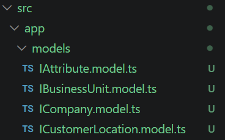

# Angular assignment - Attribute management

## Assignment - 1

### Task 1 - Create a new angular application

- Project initialization       


- Why does Angular offer both approaches?      
Angular offers both approaches because the ngModule approach has been present since a very long time and a lot of enterprise applications and packages are written in ngModule, whereas the standalone approach has been the default since Angular 17 making it backward compatible and easier to learn and use Angular.

- In what kind of project would you pick standalone over NgModule?      
Standalone has been the default approach that Angular has opted since Angular 17 because it reduces a lot of boilerplate code and makes development easier and faster as compared to NgModules. I would prefer standalone over NgModules in almost every situation where we don't have to explicity use the rigid, heavy modular approach provided by the NgModules.

### Task 2 - Create TypeScript interfaces



### Task 3 - Create Attribute Service

- Create AttributeService


- In-memory array of at least 8 diverse Attribute records


- What would change if you provided this service at component level? When would you choose that?             
If this service was provided at a component level, then we would have to describe the in memory attribute array and all the related methods to the attribute array in each and every component where it is used, whereas with the service AttributeService we have a global store through which all the components can share the data instead of repeating the same code at multiple places. I would choose the component level definition of the array and methods where only that specific component uses the data and methods of the service.

### Task 4 - Create AttributeListComponent

- Create AttributeListComponent


- Attribute list


### Task 5 - Create AttributeCardComponent 

- Create AttributeCardComponent 


- Attribute card view


- Attribute table view


### Task 6 - Implement ngOnInit, ngOnChanges, ngOnDestroy in AttributeCardComponent

- Console.log() after switching to card layout         


- Console.log() after switching back to table layout          


- In what order do hooks fire when the list loads?         
No hooks fire when the list loads since the table layout is the default layout in the attribute-list component.

- What fires when you switch between table/card view?              
When the toggle is switched from the table view to the card view, ngOnChanges and ngOnInit hooks are fired for each card with its id since the attribute-card component inherits the attributes as @Input from its parent attribute-list component and initializes the card view or layout.           
Whereas when the toggle is switched from the card view to the table view, the card layout no longer exists in the view, therefore the ngOnDestroy hook is fired for each attribute with its id.

- What fires when you remove an attribute? What real-world cleanup would you do in ngOnDestroy?           
When an attribute is removed from the list and its corresponding AttributeCard component is removed from the view, Angular calls ngOnDestroy() for that card instance. The console log displays the ID of the attribute associated with the destroyed component.         
Real world leanup that I would perform in ngOnDestroy hook is to clear up any tasks such as setTimeout and setInterval and clear up any resource which isn't needed any longer to avoid memory leak issues.

### Task 7 - Custom attribute directive appActiveStatus


### Task 8 - Create a custom pipe RelativeTimePipe


### Task 9 - Add a search box

- Add a search box        


- Why use a structural directive instead of a pipe?         
A structural directive controls whether an element exists in the DOM.
Here, it creates the row/card when the attribute matches the search
term and removes it when it doesn't.

A pipe would be more appropriate when the goal is to transform an
array into a filtered array for display.

### Task 10 - Create AddAttributeComponent


### Task 11 - Create EditAttributeComponent


### Task 12 - Comparison: Reactive Forms vs Template-driven Forms

In this project, I implemented both Angular form approaches to understand their differences in implementation, validation, maintainability, and testing.

- **Add Attribute:** Implemented using Reactive Forms (`FormGroup`, `FormControl`, and `Validators`).
- **Edit Attribute:** Implemented using Template-driven Forms (`ngModel` and `NgForm`), with existing attribute data pre-populated into the form.

#### 1. What Was Easier and Harder in This Project?

| Aspect | Reactive Forms — Add Attribute | Template-driven Forms — Edit Attribute |
|---|---|---|
| **Form setup** | Required creating a `FormGroup` and defining each control in TypeScript. | Required importing `FormsModule` and connecting template fields using `ngModel`. |
| **Initial implementation** | Required more TypeScript setup, but the form structure was explicit. | Was quicker to get started with for a relatively simple form. |
| **Validation** | Validators were configured centrally using `Validators.required`, `Validators.minLength`, and a custom validator. | Validation was configured in the template using attributes such as `required`, `minlength`, and `maxlength`. |
| **Dependent dropdowns** | `valueChanges` made it straightforward to respond to Business Unit changes and filter Customer Locations. | Required handling template events and synchronizing the component's form model with dropdown selections. |
| **Pre-populating data** | Values can be set using methods such as `setValue()` and `patchValue()`. | Existing values can be assigned to the component model and displayed using `ngModel`. |
| **Form state** | Control values, validity, touched state, and dirty state are accessible through the form model. | `NgForm` exposes validity and dirty state, but controls must be registered and connected correctly. |
| **Maintainability** | Complex validation and dynamic form behavior can be organized in TypeScript. | Can become harder to manage when the template grows and contains extensive validation or conditional logic. |

**What I learned:**

Reactive Forms required more initial TypeScript setup, but they made validation and dependent dropdown behavior easier to organize and understand. Template-driven Forms were relatively quick to implement for the Edit form because the fields could be connected directly to the component model using `ngModel`.

However, the Template-driven approach requires careful management of form state, control registration, and changes to related dropdowns.

#### 2. When Would I Choose Each Approach in a Real Project?

##### Reactive Forms

I would choose Reactive Forms when:

- The form contains many fields or complex validation rules.
- Fields depend on other fields, such as Customer Location depending on Business Unit.
- The form requires dynamic controls or `FormArray`.
- Validation logic needs to be reused or maintained separately from the HTML template.
- The application requires explicit control over form state and validation.

**Examples:**
- Employee onboarding workflows.
- Product configuration forms.
- Registration workflows with complex validation.
- Multi-step forms with conditional fields.

##### Template-driven Forms

I would choose Template-driven Forms when:

- The form is relatively small and straightforward.
- Most validation can be expressed using standard HTML attributes and Angular template directives.
- The form has limited dynamic behavior.
- The team prefers keeping most of the form configuration in the template.

**Examples:**
- Simple contact forms.
- Basic feedback forms.
- Small settings forms with a few fields.

#### 3. Which Approach Is Easier to Unit Test, and Why?

**Reactive Forms are generally more convenient for unit testing complex form behavior.**

Reactive Forms expose their structure directly through TypeScript. A unit test can set control values, trigger validation, and check the form's validity without relying heavily on template interactions.

For example, to test whether the attribute name is valid:

```typescript
component.attributeForm.controls.AttributeName.setValue('Department');

expect(
  component.attributeForm.controls.AttributeName.valid
).toBeTrue();
```

To verify that the required validator works:

```typescript
component.attributeForm.controls.AttributeName.setValue('');

expect(
  component.attributeForm.controls.AttributeName.hasError('required')
).toBeTrue();
```

Template-driven Forms can also be unit tested. However, Angular needs to initialize the template and register its `ngModel` controls before assertions can reliably inspect the form state. This can require additional fixture setup and asynchronous change detection.

Therefore, Reactive Forms are generally easier to test when a form contains complex validation rules, dynamic controls, or substantial programmatic behavior. Template-driven Forms remain testable and are suitable for simpler forms.

#### 4. Conclusion

Both approaches are useful, and neither is universally better.

In this project, Reactive Forms were a good fit for **Add Attribute** because the form uses a custom attribute-name validator and a dependent Customer Location dropdown. Template-driven Forms provided an opportunity to implement **Edit Attribute** using `ngModel` and `NgForm`.

For a production application with complex forms, I would generally prefer Reactive Forms because their explicit structure, centralized validation configuration, and programmatic control make them easier to maintain and test.

For smaller forms with minimal logic, Template-driven Forms can reduce the amount of setup required.

Ultimately, I would choose the approach based on the form's complexity, validation requirements, maintainability, and testing needs rather than using one approach for every form.